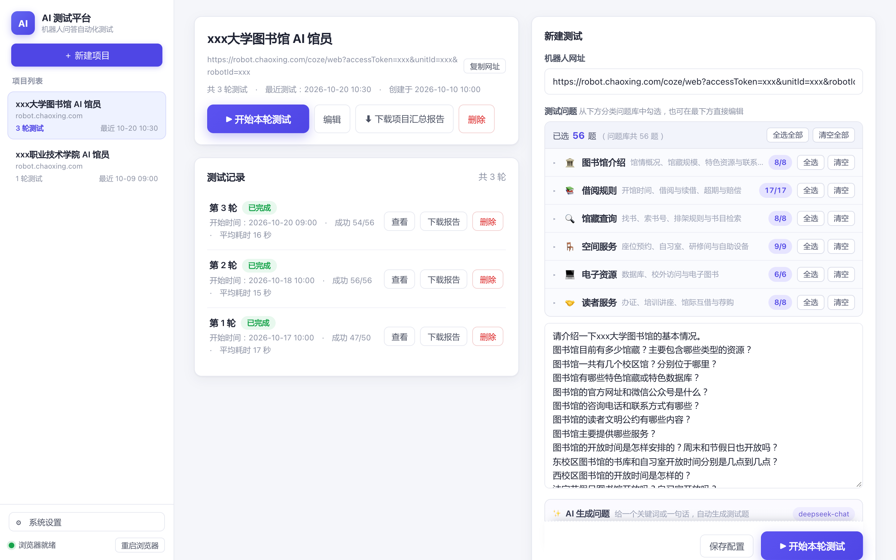
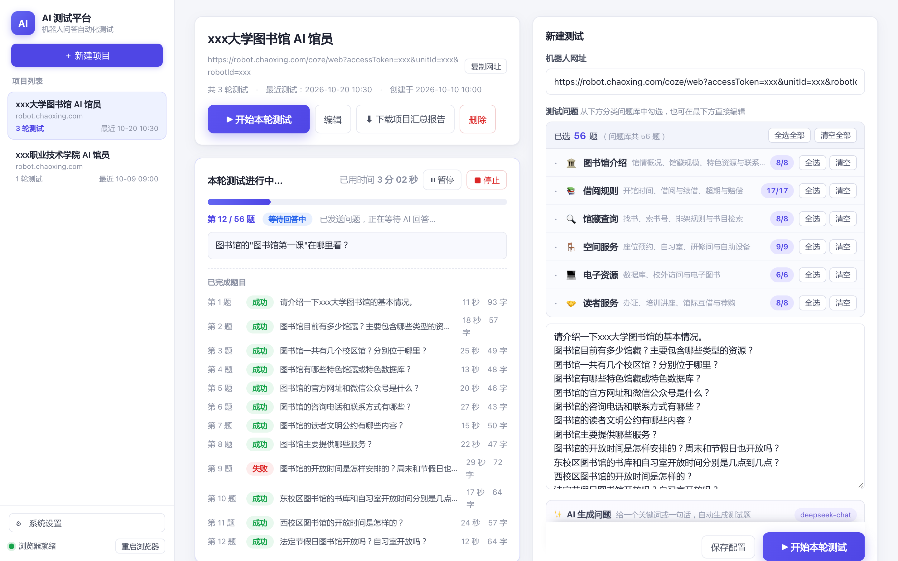
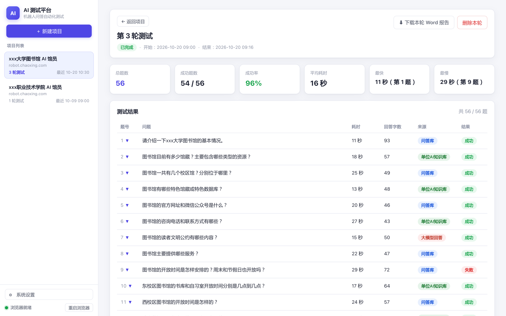
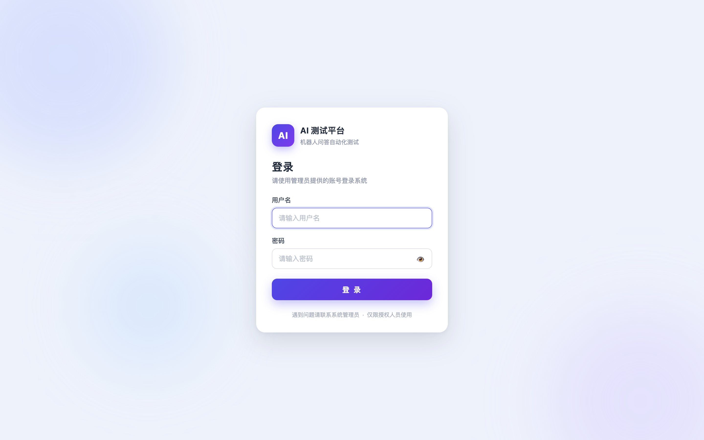

# AI 智能体测试工具

面向 **AI 馆员 / AI 问答机器人** 的自动化测试平台：给它一个问答机器人网址和一组测试问题，点一下就能跑完一轮问答测试，自动记录每道题的回答、回答来源、耗时和页面截图，并一键导出 Word 测试报告；同一个项目可以跑多轮，自动形成测试记录和跨轮次对比。

> 示例截图中的「xxx大学」和测试数据均为演示数据。



## 功能特性

- **一键自动化问答**：自动打开机器人页面、逐题提问、等待回答，最多重试 3 次。
- **回答来源标注**：按页面署名 / 检索过程区分「问答库」「单位 AI 知识库」「大模型回答」，颜色区分，红色题目重点复核。
- **页面截图留证**：每题保存回答时的页面截图，报告里图文对照。
- **多轮对比**：同一项目可反复测试，保留每轮记录，支持轮次间对比。
- **Word 报告**：单轮报告 + 项目汇总报告，自动带截图。
- **测试问题库**：按图书馆业务分 6 类共 56 题，可勾选、可编辑，也支持 AI 生成问题。
- **暂停 / 继续 / 停止**：测试过程可随时干预，停止后已完成结果与截图不丢。
- **登录保护**：内置登录页（见 `auth/`），适合通过 Cloudflare Tunnel / Tailscale Funnel 映射到外网。

| 运行中 | 测试结果 |
|---|---|
|  |  |

## 快速开始

### 方式一：Docker（推荐）

```bash
git clone <本仓库地址> ai-agent-test-tool
cd ai-agent-test-tool

docker compose up -d --build
```

打开 <http://127.0.0.1:3789> 即可使用。

### 方式二：本地 Node.js

```bash
node -v            # 需要 Node.js 20+
npm install
node server.js     # 默认监听 3789
```

## 使用流程

1. 左侧「＋ 新建项目」，填写项目名称、机器人完整网址（含 accessToken 等参数）。
2. 从问题库勾选测试问题，或直接编辑 / 用 AI 生成。
3. 点「▶ 开始本轮测试」，页面实时显示进度，可暂停、继续、停止。
4. 跑完后点测试记录的「查看」，逐题查看回答、来源与页面截图。
5. 下载「本轮 Word 报告」或「项目汇总报告」。

完整图文说明见 [操作手册](docs/AI智能体测试工具-操作手册.docx)（Word，7 页）。更早的纯文字版说明见 [docs/使用说明.md](docs/使用说明.md)。

## 外网访问与登录

生产部署建议：应用只监听本机 → nginx（登录校验）→ Cloudflare Tunnel 或 Tailscale Funnel 对外。仓库里带了整套配置：

- `auth/`：登录服务（登录页、会话 Cookie、退出、改密码）
- `deploy/nginx-ai-tester.conf`：nginx 站点配置（未登录跳登录页，API 返回 401）
- `deploy/ai-auth.service`：登录服务 systemd 单元
- `deploy/DEPLOY.md`：**完整部署步骤**

登录页效果：



## 目录结构

```
.
├── server.js              # HTTP 服务与接口
├── lib/                   # 浏览器控制、提问引擎、报告、存储、问题库
├── public/                # 前端页面（原生 JS）
├── docker/                # 容器启动脚本（Xvfb + x11vnc + noVNC + Node）
├── Dockerfile
├── docker-compose.yml
├── auth/                  # 登录服务（Python 标准库）
├── deploy/                # nginx / systemd / 部署文档
├── docs/
│   ├── AI智能体测试工具-操作手册.docx
│   ├── 使用说明.md
│   └── images/            # 截图（演示数据）
├── tools/                 # 开发调试脚本
└── API.md                 # HTTP 接口说明
```

## 数据与安全

- 项目、轮次、截图、报告和设置保存在 `data/`，**不要提交到 Git**（已在 `.gitignore` 中排除）。
- AI 生成问题用的 API Key 保存在 `data/settings.json`，也可用环境变量 `DEEPSEEK_API_KEY` 覆盖。
- 受控浏览器的登录态保存在 Docker 卷里，可能包含目标站点的登录 Cookie，注意备份与访问控制。
- 本工具会真实操作目标网页并发起提问，**请仅用于你拥有或已获授权的系统**，并遵守目标站点的使用条款。

## 许可

本项目未附加开源许可协议；如需开源请自行添加 LICENSE。
